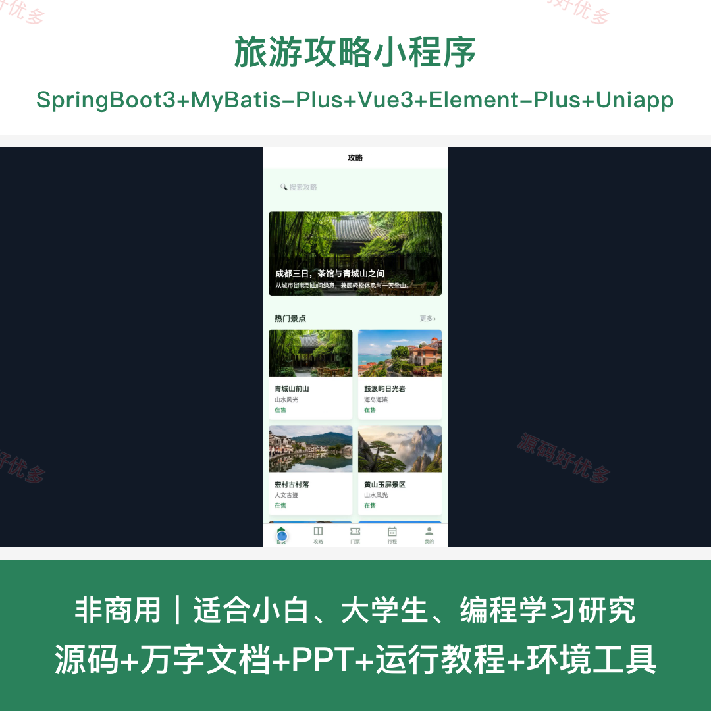
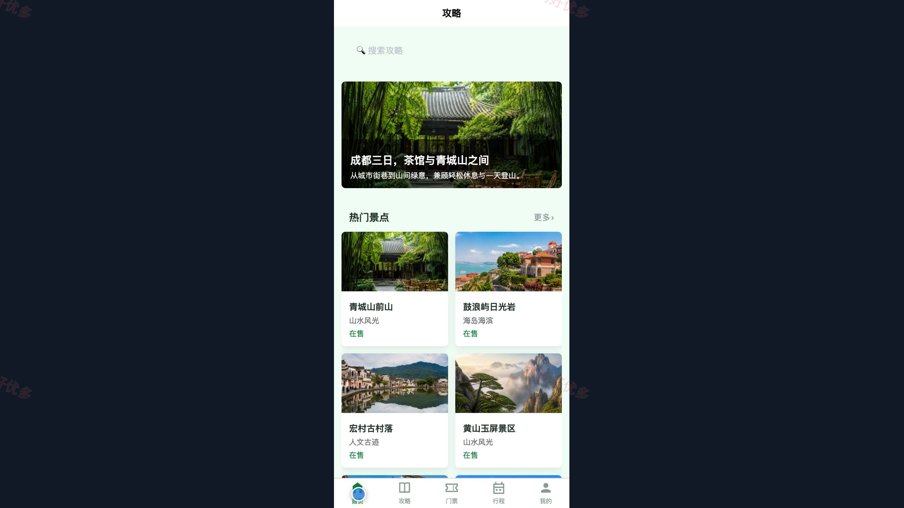
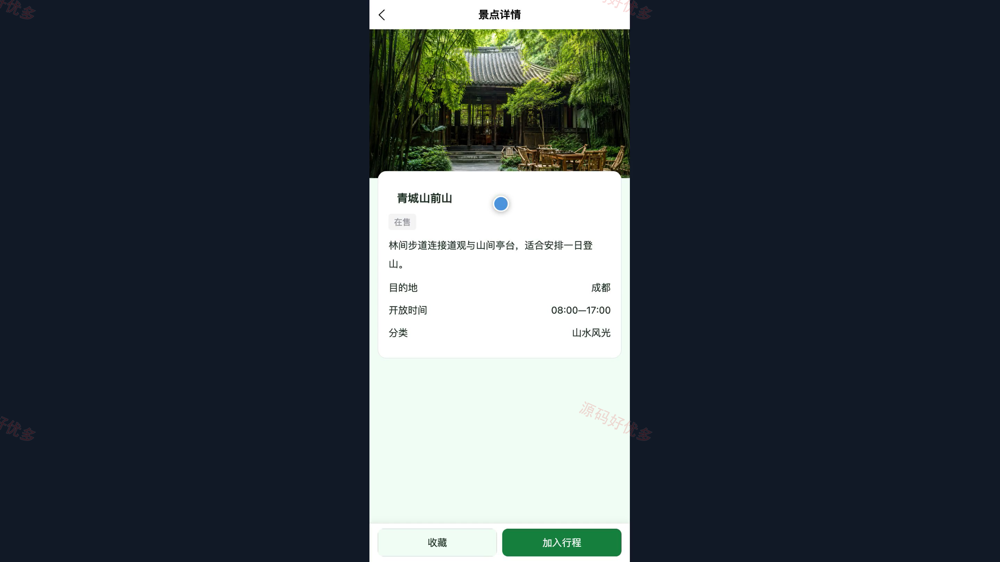
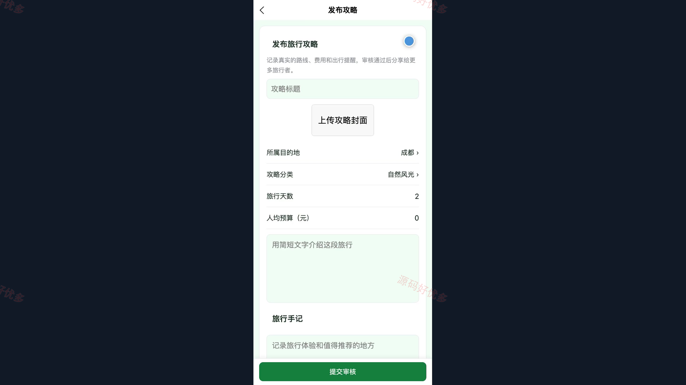
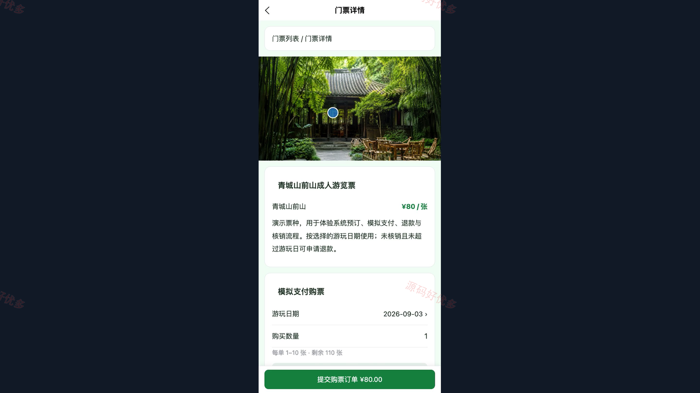
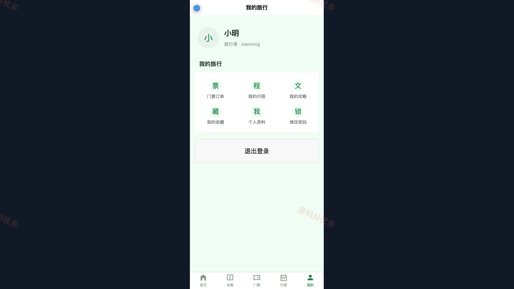
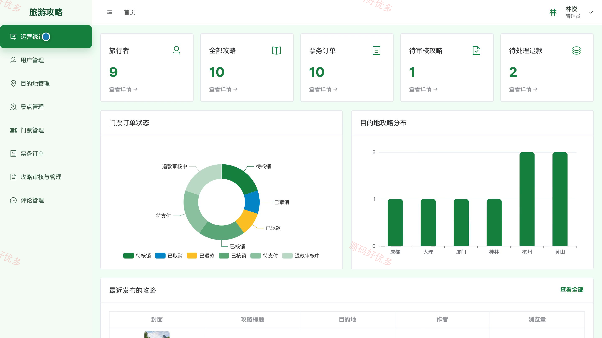
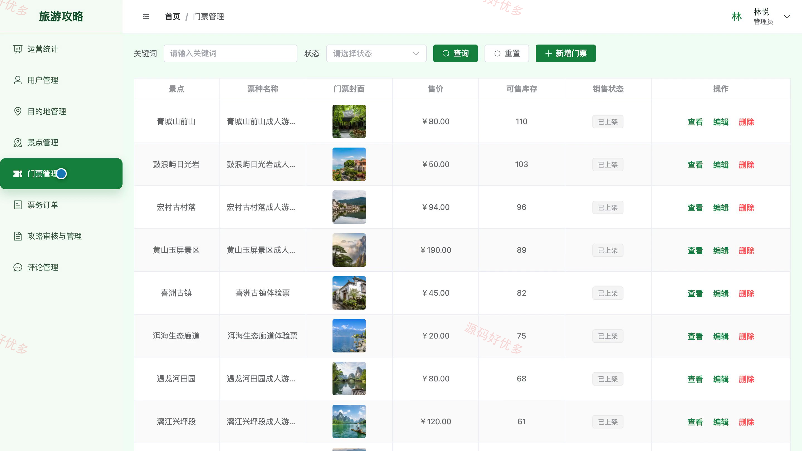
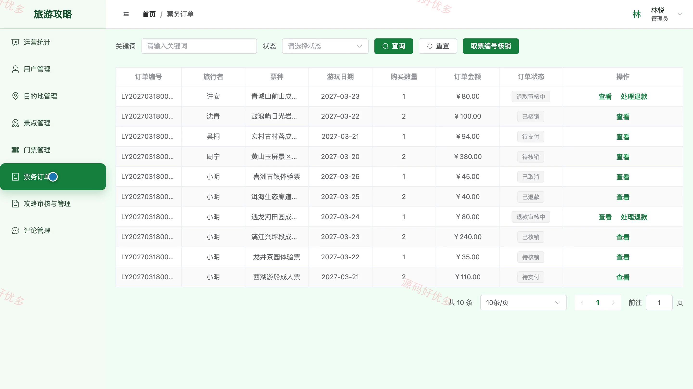

## 源码问题查看主页咨询

### 一、关键词
旅游攻略、自由行指南、目的地推荐、行程规划、景点门票

### 二、作品包含
源码+数据库+万字设计文档+PPT+全套环境和工具资源+本地部署教程

### 三、项目技术
前端技术： Html、Css、Js、Vue3.4、Element-Plus、uniapp
后端技术：Java、SpringBoot3.2.0、MyBatis-Plus

### 四、运行环境要求
开发工具：IDEA/eclipse + VSCODE + HBuilder X + 微信开发者工具

数据库：MySQL5.7+（共13张表）

数据库管理工具：Navicat10以上版本

环境配置软件： JDK17 + Maven3.6

前端Nodejs：16+

浏览器：谷歌浏览器

### 五、项目介绍
项目编号：bs114B

旅游攻略小程序面向旅行者与管理员，支持目的地和景点浏览、攻略检索与发布、收藏评论、行程编排、门票购买及订单跟踪，并由后台完成用户、旅游资源、攻略审核、票务订单和运营数据维护。

角色：旅行者、管理员

旅行者功能：注册登录、目的地与景点浏览、攻略检索与详情查看、攻略发布与审核跟踪、景点和攻略收藏评论、旅行行程规划、景点门票购买、门票订单查询与退款。

管理员功能：旅行者用户管理、目的地管理、景点管理、门票票种与库存管理、票务订单核销与退款处理、攻略审核与发布管理、评论内容管理、旅游运营统计。

### 六、运行截图

